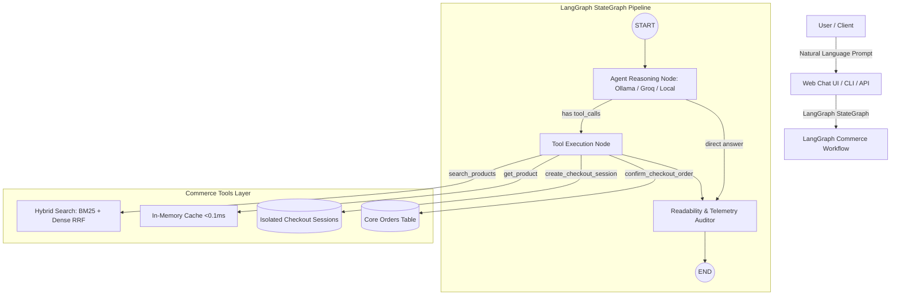

# AgentEcom: 4-Pillar Autonomous AI Commerce Engine (FastMCP + LangGraph)

[](https://www.python.org/downloads/)
[](https://modelcontextprotocol.io)
[](https://langchain.com)
[](https://langchain-ai.github.io/langgraph/)
[](https://fastapi.tiangolo.com)
[](https://shopify.dev)
[]()
[]()

**AgentEcom** is a high-throughput, low-latency e-commerce engine and **LangGraph Autonomous Shopping Agent** redesigned into a modular, production-ready **4-Pillar Architecture**:

```
+----------------------------------------------------------------------------------------------------+
|                                    4-PILLAR AGENTECOM ARCHITECTURE                                  |
+-----------------------------------+-----------------------------------+----------------------------+
|  1. FastMCP SERVICE (/mcp)        |  2. AGENT SERVICE (LangGraph)     |  3. BACKEND ENGINE (FastAPI)|
|  - FastMCP Server (MCP v2024-11-05)|  - Multi-Turn StateGraph Pipeline |  - REST & SSE Endpoints     |
|  - 13 MCP Commerce Tools          |  - FastMCP Dynamic Tool Adapter   |  - Sub-0.1ms Cache Layer   |
|  - 5 Versioned Prompt Templates   |  - Multi-Model Fallback Cascade   |  - Shopify HMAC Webhooks   |
|  - 5 MCP URI Resources            |  - Token Economy Telemetry Audit  |  - Isolated Checkouts (TTL)|
|  - Secure Database Gateway        |  - Short-Term & Persona Memory    |  - Background Search Queue |
+-----------------------------------+-----------------------------------+----------------------------+
|                                    4. FRONTEND & STOREFRONT WIDGET                                 |
|  - Conversational Storefront UI with Streaming Markdown & Product Cards                            |
|  - Interactive FastMCP Inspector & JSON-RPC 2.0 Tester                                            |
|  - Live Architecture Topology Map & Telemetry Dashboard                                           |
|  - Embeddable Shopify Floating Widget (<script src="/widget.js">)                                  |
+----------------------------------------------------------------------------------------------------+
```

---

## 🏗️ The 4 Architectural Pillars

### 1. FastMCP Service (`agentecom/mcp/`)
The centralized intelligence and data gateway implementing the official **Model Context Protocol (MCP v2024-11-05)**:
- **FastMCP Server (`server.py`)**: Supports JSON-RPC 2.0, SSE streaming transport (`/mcp/sse`), HTTP RPC (`/mcp/rpc`), in-memory direct transport, and CLI `stdio` mode (Claude Desktop & Cursor ready).
- **Tools (`tools.py`)**: 13 `@fastmcp.tool()` definitions covering catalog search, SKU lookup, stock verification, idempotent checkout sessions, order confirmations, shipment tracking, order cancellations, and item swaps.
- **Prompts (`prompts.py`)**: 5 versioned `@fastmcp.prompt()` templates including `shopping_assistant`, `product_advisor`, `checkout_guidance`, and `returns_and_policy`.
- **Resources & Database Gateway (`gateway.py`)**: `@fastmcp.resource()` endpoints exposing `schema://database`, `catalog://categories`, `catalog://featured`, `policies://store`, and `orders://{order_number}`.
- **Client (`client.py`)**: Zero-overhead in-memory and HTTP/SSE MCP client for direct communication.

### 2. Autonomous Agent Service (`agentecom/agent/`)
- **LangGraph StateGraph Engine (`graph.py`)**: Autonomous ReAct loop coordinating agent reasoning, MCP tool dispatch, and AI readability telemetry.
- **MCP Adapter (`mcp_adapter.py`)**: Dynamically extracts FastMCP tools and prompts into LangChain `BaseTool` instances at runtime.
- **Resilient Fallback Cascade (`providers.py`)**: Automatically cascades across providers: **Groq API -> Google Gemini -> OpenRouter -> Local Deterministic Zero-Key Fallback**.
- **AI Readability & Token Economy Telemetry**: Audits token compression, reduction percentage, execution latency, and cache hit metrics on every turn.

### 3. Backend Engine (`agentecom/api/` & `agentecom/core/`)
- **FastAPI Core (`main.py`)**: Mounts FastMCP at `/mcp`, agent chat & streaming SSE at `/api/v1/agent`, catalog at `/api/v1/catalog`, merchant operations at `/api/v1/merchant`, and checkout at `/api/v1/checkout`.
- **Retail Store Owner Service (`services/merchant.py`)**: High-level store personnel operations for catalog creation, real-time stock adjustment, price editing, and KPI metrics. Changes immediately sync to SQLite, invalidate targeted cache keys, and re-index vector/BM25 structures for the AI Agent.
- **Surgical Invalidation Caching (`cache.py`)**: Sub-millisecond reads (**0.031 ms**) with tag-based reverse indexing for targeted SKU/Category invalidation.
- **HMAC-Secured Webhooks (`webhooks.py`)**: Zero-polling Shopify webhook sync for product and inventory mutations.
- **Hybrid Search Engine (`search/hybrid.py`)**: BM25 Lexical + Dense MiniLM Vectors + Reciprocal Rank Fusion (**100% Recall@1, 1.0 MRR**).

### 4. Modern Frontend & Portals (`agentecom/web/`)
- **Conversational UI (`index.html`)**: Real-time chat with streaming markdown, interactive product recommendation cards, and cart drawer.
- **Retail Store Manager Portal**: Dedicated merchant dashboard to add products, adjust live stock (`+1`, `+10`, `-1`, exact count), modify prices, and monitor catalog valuation and low-stock alerts.
- **FastMCP Inspector**: Interactive browser panel to browse registered MCP tools, inspect input schemas, render prompts, and run raw JSON-RPC 2.0 queries.
- **Architecture Topology Explorer**: Live visualization of data and control flow across the 4 services.
- **Embeddable Storefront Widget (`widget.js`)**: Single-line drop-in floating chat assistant for external storefronts and Shopify themes.

---

## 📌 Project Status: Ready & Verified

- **LangGraph StateGraph Workflow**: Autonomous multi-turn ReAct reasoning loop with tools, session memory, and AI Readability audit.
- **Shopify Platform Integration**:
  - **Catalog Ingestion & Sync**: Ingests real products and variants (SKUs, options, inventory, pricing, tags) directly into the BM25 + Dense vector Hybrid Search engine.
  - **HMAC-Secured Webhooks**: Zero-polling, real-time sync on `products/create`, `products/update`, `products/delete`, and `inventory_levels/update`.
  - **1-Click Checkout Permalinks**: Generates pre-filled Shopify checkout URLs (`/cart/{variant_id}:{qty}`) with isolated session staging.
  - **Embeddable Storefront Chat Widget**: Lightweight, drop-in `<script src="/widget.js">` floating chat for any Shopify theme.
- **Provider Switching (Ollama & Groq API)**:
  - **Ollama**: Local LLMs (`llama3.2`, `mistral`, `qwen2.5`) via `ChatOllama`.
  - **Groq API**: High-speed cloud LLMs (`llama-3.3-70b-versatile`, `mixtral-8x7b-32768`) via `ChatGroq`.
  - **Local Zero-Key Fallback**: Instant local intent planner requiring zero external API keys.
- **Interactive Conversational UI**: Served at `http://localhost:8000/chat` and `/` featuring live chat, product recommendation cards, cart preview, and real-time **AI Readability & Token Economy Telemetry**.
- **Interactive CLI**: Terminal chatbot via `python -m agentecom.agent_cli`.
- **Aggressive Caching**: Sub-millisecond reads (**0.031 ms**, 227.2x speedup) with precise tag-based reverse indexing.
- **Webhook-Based Invalidation**: Zero-polling, real-time cache invalidation triggered on merchant DB updates.
- **Hybrid Search Engine**: BM25 Sparse Lexical + Dense Vector Embeddings + Reciprocal Rank Fusion (RRF). **100% Recall@1, 100% Recall@3, 100% Recall@5, and 1.0 MRR** on golden agent evaluation queries.
- **Isolated Idempotent Checkout**: Short-TTL (15 min) transient checkout sessions segregated from core `orders` table; guarantees zero duplicate orders or double charges on agent retries.
- **Automated Tests**: 18/18 integration and unit tests passing.

---

## 🏗️ Architecture & LangGraph Workflow



---

## ⚡ Key Architectural Pillars

### 1. LangGraph StateGraph Shopping Agent
- Multi-turn conversational state tracking (`messages`, `cart`, `checkout_session`, `order`, `readability`).
- Autonomous tool-calling with `search_products`, `get_product_details`, `check_inventory_stock`, `create_checkout_session`, and `confirm_checkout_order`.
- Computes **AI Readability & Token Economy** metrics: estimated raw tokens vs compressed tool tokens, token reduction %, latency, and cache hits.

### 2. Catalog API — Cache Aggressively, Invalidate Precisely
- In-memory / Redis cache sits in front of the database, keyed by SKU, Category, and Query hash.
- **Webhook-driven Invalidation**: When merchant DB updates price or stock, targeted webhooks invalidate only the affected SKU/category keys. Eliminates TTL polling, stale pricing, and database thrashing.
- Achieves **0.031 ms** read latency (compared to 7.043 ms on direct DB queries).

### 3. Search Engine — Hybrid Search (Don't Reach for a Separate Vector DB by Default)
- **Why Hybrid**: BM25 excels at exact matches (SKU codes like `SKU-4471`, brand models like `SONY-WH1000XM5`), while dense vector retrieval catches semantic / paraphrased queries (`"cozy oversized sweater for winter"`).
- **Reciprocal Rank Fusion (RRF)**:
  $$\text{Score}_{\text{RRF}}(d) = \sum_{m \in \{\text{bm25}, \text{dense}\}} \frac{w_m}{k + \text{rank}_m(d)}$$
- **Decoupled Ingestion**: Product embedding generation runs asynchronously in background queues — never blocking the agent search request path or merchant DB writes.

### 4. Checkout Sessions — Short-Lived, Idempotent, Isolated
- Short-TTL checkout sessions (15 minutes) stored in a dedicated table isolated from the core `orders` table.
- Prevents abandoned or exploratory agent sessions from polluting production sales analytics.
- Enforces `Idempotency-Key` headers on creation and confirmation to prevent double-charging and duplicate order placement during agent retries.

---

## 📊 Retrieval Quality Benchmark Results

Evaluated against the golden agent query dataset (`python -m agentecom.eval.eval_retrieval`):

| Retrieval Mode | Recall@1 (%) | Recall@3 (%) | Recall@5 (%) | MRR (Mean Reciprocal Rank) | Avg Latency (ms) | P50 Latency (ms) |
| :--- | :---: | :---: | :---: | :---: | :---: | :---: |
| **1. Sparse BM25 (Lexical Only)** | 100.0% | 100.0% | 100.0% | 1.0000 | 0.189 ms | 0.177 ms |
| **2. Dense Vector (Semantic Only)** | 87.5% | 93.75% | 93.75% | 0.9062 | 16.226 ms | 16.044 ms |
| **3. Hybrid RRF (BM25 + Dense)** | **100.0%** | **100.0%** | **100.0%** | **1.0000** | **15.265 ms** | **15.292 ms** |

---

## 📁 Repository Structure

```
AgentEcom/
├── agentecom/
│   ├── agent/               # LangGraph Agent Core
│   │   ├── graph.py         # StateGraph workflow (Ollama / Groq / Local)
│   │   ├── state.py         # AgentState & Pydantic response schemas
│   │   ├── engine.py        # Autonomous agent engine interface
│   │   └── tools_langchain.py # LangChain @tool wrappers
│   ├── api/
│   │   ├── routes/
│   │   │   ├── agent.py     # Multi-turn chat & session management endpoints
│   │   │   ├── catalog.py   # Cached product & stock endpoints
│   │   │   ├── merchant.py  # Retail store owner catalog, stock & pricing operations
│   │   │   ├── search.py    # Hybrid search endpoint
│   │   │   ├── checkout.py  # Isolated session & idempotent order endpoints
│   │   │   ├── webhooks.py  # Merchant DB sync webhook receiver
│   │   │   └── tools.py     # LLM tool execution & JSON schema endpoints
│   │   └── main.py          # FastAPI app serving Web UI at /chat and /
│   ├── services/
│   │   └── merchant.py      # MerchantService for adding products, stock & pricing
│   ├── core/
│   │   ├── cache.py         # Aggressive cache with reverse tag indexing
│   │   └── checkout.py      # Checkout session isolation & idempotency logic
│   ├── db/
│   │   ├── database.py      # SQLAlchemy async engine (NullPool)
│   │   ├── models.py        # Product, Inventory, CheckoutSession, Order models
│   │   └── seed.py          # Curated product catalog dataset
│   ├── eval/
│   │   ├── dataset.py       # Golden agent query evaluation dataset
│   │   └── eval_retrieval.py # Automated Recall@k & MRR benchmark script
│   ├── integrations/        # E-Commerce Platform Connectors
│   │   └── shopify/
│   │       ├── client.py    # Shopify Admin REST/GraphQL & HMAC verification
│   │       └── sync.py      # Catalog ingestion into BM25 + Vector Search
│   ├── search/
│   │   ├── bm25_retriever.py # Tokenized lexical BM25 engine
│   │   ├── dense_retriever.py # Local sentence-transformers vector retriever
│   │   ├── hybrid.py        # Reciprocal Rank Fusion hybrid search engine
│   │   └── worker.py        # Decoupled async indexing worker
│   ├── web/
│   │   ├── index.html       # Web Chat UI & Readability Inspector
│   │   └── widget.js        # Embeddable Storefront Chat Widget for Shopify
│   ├── agent_cli.py         # Interactive Terminal Chat CLI
│   ├── config.py            # Application settings
│   └── demo.py              # Interactive live demonstration script
├── tests/
│   ├── test_ai_agent.py     # LangGraph agent multi-turn conversation tests
│   ├── test_catalog_cache.py # Cache hits, misses, latency tests
│   ├── test_webhook_invalidation.py # Surgical invalidation tests
│   ├── test_hybrid_search.py # BM25, Dense, RRF tests
│   ├── test_checkout_idempotency.py # Session isolation & idempotency tests
│   ├── test_commerce_tools.py # Agent tool execution tests
│   └── test_shopify_integration.py # Shopify client, sync & webhook tests
├── pytest.ini               # Pytest configuration
├── requirements.txt         # Project dependencies
├── .gitignore               # Git ignore rules
└── README.md                # Project documentation
```

---

## 🚀 Quickstart Guide

### 1. Activate Virtual Environment
```powershell
# Windows
.\.venv\Scripts\Activate.ps1
```

### 2. Launch the Web Chat Interface
```powershell
uvicorn agentecom.api.main:app --reload --port 8000
```
- Open browser at `http://localhost:8000/chat` (or `http://localhost:8000`).
- Switch between **Local Zero-Key**, **Ollama**, and **Groq API** directly in the top header.
- Inspect real-time **AI Readability & Token Economy** metrics in the right sidebar.

### 3. Run Interactive Terminal CLI
```powershell
python -m agentecom.agent_cli
```

### 4. Run Automated Test Suite
```powershell
pytest tests/ -v
```

### 5. Run Retrieval Evaluation Suite
```powershell
python -m agentecom.eval.eval_retrieval
```

---

## 🐳 Docker & Microservices Containerization

AgentEcom is completely modularized with individual Dockerfiles for each service and orchestrated via Docker Compose:

### 1. Services Overview

| Container Service | Dockerfile | Default Port | Description |
| :--- | :--- | :--- | :--- |
| **`agentecom-api`** | [`docker/Dockerfile.api`](file:///d:/projects/AgentEcom/docker/Dockerfile.api) | `8000:8000` | FastAPI Web Application, Commerce REST API, Merchant Dashboard & Webhook ingestion |
| **`agentecom-mcp`** | [`docker/Dockerfile.mcp`](file:///d:/projects/AgentEcom/docker/Dockerfile.mcp) | `8001:8001` | Dedicated FastMCP Protocol (v2024-11-05) Server (SSE, JSON-RPC, 13 Tools, 5 Prompts, 5 Resources) |
| **`agentecom-worker`** | [`docker/Dockerfile.worker`](file:///d:/projects/AgentEcom/docker/Dockerfile.worker) | N/A (worker) | Asynchronous background worker for dense vector embedding generation and BM25 catalog indexing |
| **`agentecom-cli`** | [`docker/Dockerfile.cli`](file:///d:/projects/AgentEcom/docker/Dockerfile.cli) | Interactive CLI | Interactive terminal-based AI shopping assistant |

---

### 2. Building & Running Services Separately

#### A. Core Commerce API & Web Storefront
```bash
# Build the API image
docker build -f docker/Dockerfile.api -t agentecom-api .

# Run the API container
docker run -d --name agentecom-api \
  -p 8000:8000 \
  -v agentecom-data:/app/data \
  agentecom-api
```
- Open `http://localhost:8000` for Storefront & AI Chatbot
- Open `http://localhost:8000/docs` for Swagger REST documentation

#### B. Dedicated FastMCP Microservice
```bash
# Build the FastMCP image
docker build -f docker/Dockerfile.mcp -t agentecom-mcp .

# Run the FastMCP container
docker run -d --name agentecom-mcp \
  -p 8001:8001 \
  -v agentecom-data:/app/data \
  agentecom-mcp
```
- Health probe: `http://localhost:8001/health`
- MCP SSE Endpoint: `http://localhost:8001/sse`
- MCP JSON-RPC 2.0: `http://localhost:8001/rpc`

#### C. Asynchronous Indexing Worker
```bash
# Build the background worker
docker build -f docker/Dockerfile.worker -t agentecom-worker .

# Run the worker container
docker run -d --name agentecom-worker \
  -v agentecom-data:/app/data \
  agentecom-worker
```

#### D. Interactive Terminal CLI
```bash
# Build the CLI container
docker build -f docker/Dockerfile.cli -t agentecom-cli .

# Run interactive terminal shopping session
docker run -it --rm \
  -v agentecom-data:/app/data \
  agentecom-cli
```

---

### 3. Orchestrating All Services with Docker Compose

To boot the entire multi-service mesh with shared volumes, health monitoring, and network routing in one command:

```bash
# Start all microservices in the background
docker-compose up -d

# View real-time aggregated service logs
docker-compose logs -f

# Run the interactive AI shopping assistant inside the network
docker-compose run --rm agentecom-cli

# Stop all services and network
docker-compose down
```

