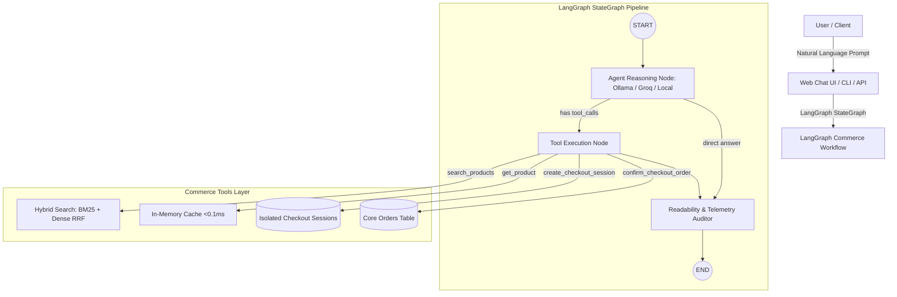

# AgentEcom: Autonomous AI Commerce Engine (LangGraph + Ollama / Groq)

[](https://www.python.org/downloads/)
[](https://langchain.com)
[](https://langchain-ai.github.io/langgraph/)
[](https://fastapi.tiangolo.com)
[]()
[]()

**AgentEcom** is a high-throughput, low-latency e-commerce engine and **LangGraph Autonomous Shopping Agent** designed for AI workflows (autonomous shopping agents, conversational checkout assistants, and multi-agent commerce).

---

## 📌 Project Status: Ready & Verified

- **LangGraph StateGraph Workflow**: Autonomous multi-turn ReAct reasoning loop with tools, session memory, and AI Readability audit.
- **Provider Switching (Ollama & Groq API)**:
  - **Ollama**: Local LLMs (`llama3.2`, `mistral`, `qwen2.5`) via `ChatOllama`.
  - **Groq API**: High-speed cloud LLMs (`llama-3.3-70b-versatile`, `mixtral-8x7b-32768`) via `ChatGroq`.
  - **Local Zero-Key Fallback**: Instant local intent planner requiring zero external API keys.
- **Interactive Conversational UI**: Served at `http://localhost:8000/chat` and `/` featuring live chat, product recommendation cards, cart preview, and real-time **AI Readability & Token Economy Telemetry**.
- **Interactive CLI**: Terminal chatbot via `python -m agentecom.agent_cli`.
- **Aggressive Caching**: Sub-millisecond reads (**0.031 ms**, 227.2x speedup) with precise tag-based reverse indexing.
- **Webhook-Based Invalidation**: Zero-polling, real-time cache invalidation triggered on merchant DB updates.
- **Hybrid Search Engine**: BM25 Sparse Lexical + Dense Vector Embeddings + Reciprocal Rank Fusion (RRF). **100% Recall@1, 100% Recall@3, 100% Recall@5, and 1.0 MRR** on golden agent evaluation queries.
- **Isolated Idempotent Checkout**: Short-TTL (15 min) transient checkout sessions segregated from core `orders` table; guarantees zero duplicate orders or double charges on agent retries.
- **Automated Tests**: 14/14 integration and unit tests passing.

---

## 🏗️ Architecture & LangGraph Workflow



---

## ⚡ Key Architectural Pillars

### 1. LangGraph StateGraph Shopping Agent
- Multi-turn conversational state tracking (`messages`, `cart`, `checkout_session`, `order`, `readability`).
- Autonomous tool-calling with `search_products`, `get_product_details`, `check_inventory_stock`, `create_checkout_session`, and `confirm_checkout_order`.
- Computes **AI Readability & Token Economy** metrics: estimated raw tokens vs compressed tool tokens, token reduction %, latency, and cache hits.

### 2. Catalog API — Cache Aggressively, Invalidate Precisely
- In-memory / Redis cache sits in front of the database, keyed by SKU, Category, and Query hash.
- **Webhook-driven Invalidation**: When merchant DB updates price or stock, targeted webhooks invalidate only the affected SKU/category keys. Eliminates TTL polling, stale pricing, and database thrashing.
- Achieves **0.031 ms** read latency (compared to 7.043 ms on direct DB queries).

### 3. Search Engine — Hybrid Search (Don't Reach for a Separate Vector DB by Default)
- **Why Hybrid**: BM25 excels at exact matches (SKU codes like `SKU-4471`, brand models like `SONY-WH1000XM5`), while dense vector retrieval catches semantic / paraphrased queries (`"cozy oversized sweater for winter"`).
- **Reciprocal Rank Fusion (RRF)**:
  $$\text{Score}_{\text{RRF}}(d) = \sum_{m \in \{\text{bm25}, \text{dense}\}} \frac{w_m}{k + \text{rank}_m(d)}$$
- **Decoupled Ingestion**: Product embedding generation runs asynchronously in background queues — never blocking the agent search request path or merchant DB writes.

### 4. Checkout Sessions — Short-Lived, Idempotent, Isolated
- Short-TTL checkout sessions (15 minutes) stored in a dedicated table isolated from the core `orders` table.
- Prevents abandoned or exploratory agent sessions from polluting production sales analytics.
- Enforces `Idempotency-Key` headers on creation and confirmation to prevent double-charging and duplicate order placement during agent retries.

---

## 📊 Retrieval Quality Benchmark Results

Evaluated against the golden agent query dataset (`python -m agentecom.eval.eval_retrieval`):

| Retrieval Mode | Recall@1 (%) | Recall@3 (%) | Recall@5 (%) | MRR (Mean Reciprocal Rank) | Avg Latency (ms) | P50 Latency (ms) |
| :--- | :---: | :---: | :---: | :---: | :---: | :---: |
| **1. Sparse BM25 (Lexical Only)** | 100.0% | 100.0% | 100.0% | 1.0000 | 0.189 ms | 0.177 ms |
| **2. Dense Vector (Semantic Only)** | 87.5% | 93.75% | 93.75% | 0.9062 | 16.226 ms | 16.044 ms |
| **3. Hybrid RRF (BM25 + Dense)** | **100.0%** | **100.0%** | **100.0%** | **1.0000** | **15.265 ms** | **15.292 ms** |

---

## 📁 Repository Structure

```
AgentEcom/
├── agentecom/
│   ├── agent/               # LangGraph Agent Core
│   │   ├── graph.py         # StateGraph workflow (Ollama / Groq / Local)
│   │   ├── state.py         # AgentState & Pydantic response schemas
│   │   ├── engine.py        # Autonomous agent engine interface
│   │   └── tools_langchain.py # LangChain @tool wrappers
│   ├── api/
│   │   ├── routes/
│   │   │   ├── agent.py     # Multi-turn chat & session management endpoints
│   │   │   ├── catalog.py   # Cached product & stock endpoints
│   │   │   ├── search.py    # Hybrid search endpoint
│   │   │   ├── checkout.py  # Isolated session & idempotent order endpoints
│   │   │   ├── webhooks.py  # Merchant DB sync webhook receiver
│   │   │   └── tools.py     # LLM tool execution & JSON schema endpoints
│   │   └── main.py          # FastAPI app serving Web UI at /chat and /
│   ├── core/
│   │   ├── cache.py         # Aggressive cache with reverse tag indexing
│   │   └── checkout.py      # Checkout session isolation & idempotency logic
│   ├── db/
│   │   ├── database.py      # SQLAlchemy async engine (NullPool)
│   │   ├── models.py        # Product, Inventory, CheckoutSession, Order models
│   │   └── seed.py          # Curated product catalog dataset
│   ├── eval/
│   │   ├── dataset.py       # Golden agent query evaluation dataset
│   │   └── eval_retrieval.py # Automated Recall@k & MRR benchmark script
│   ├── search/
│   │   ├── bm25_retriever.py # Tokenized lexical BM25 engine
│   │   ├── dense_retriever.py # Local sentence-transformers vector retriever
│   │   ├── hybrid.py        # Reciprocal Rank Fusion hybrid search engine
│   │   └── worker.py        # Decoupled async indexing worker
│   ├── web/
│   │   └── index.html       # Web Chat UI & Readability Inspector
│   ├── agent_cli.py         # Interactive Terminal Chat CLI
│   ├── config.py            # Application settings
│   └── demo.py              # Interactive live demonstration script
├── tests/
│   ├── test_ai_agent.py     # LangGraph agent multi-turn conversation tests
│   ├── test_catalog_cache.py # Cache hits, misses, latency tests
│   ├── test_webhook_invalidation.py # Surgical invalidation tests
│   ├── test_hybrid_search.py # BM25, Dense, RRF tests
│   ├── test_checkout_idempotency.py # Session isolation & idempotency tests
│   └── test_commerce_tools.py # Agent tool execution tests
├── pytest.ini               # Pytest configuration
├── requirements.txt         # Project dependencies
├── .gitignore               # Git ignore rules
└── README.md                # Project documentation
```

---

## 🚀 Quickstart Guide

### 1. Activate Virtual Environment
```powershell
# Windows
.\.venv\Scripts\Activate.ps1
```

### 2. Launch the Web Chat Interface
```powershell
uvicorn agentecom.api.main:app --reload --port 8000
```
- Open browser at `http://localhost:8000/chat` (or `http://localhost:8000`).
- Switch between **Local Zero-Key**, **Ollama**, and **Groq API** directly in the top header.
- Inspect real-time **AI Readability & Token Economy** metrics in the right sidebar.

### 3. Run Interactive Terminal CLI
```powershell
python -m agentecom.agent_cli
```

### 4. Run Automated Test Suite
```powershell
pytest tests/ -v
```

### 5. Run Retrieval Evaluation Suite
```powershell
python -m agentecom.eval.eval_retrieval
```
